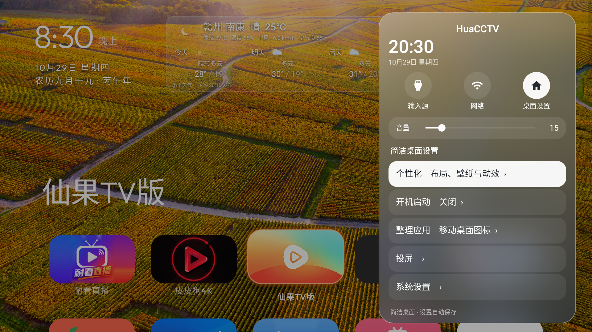
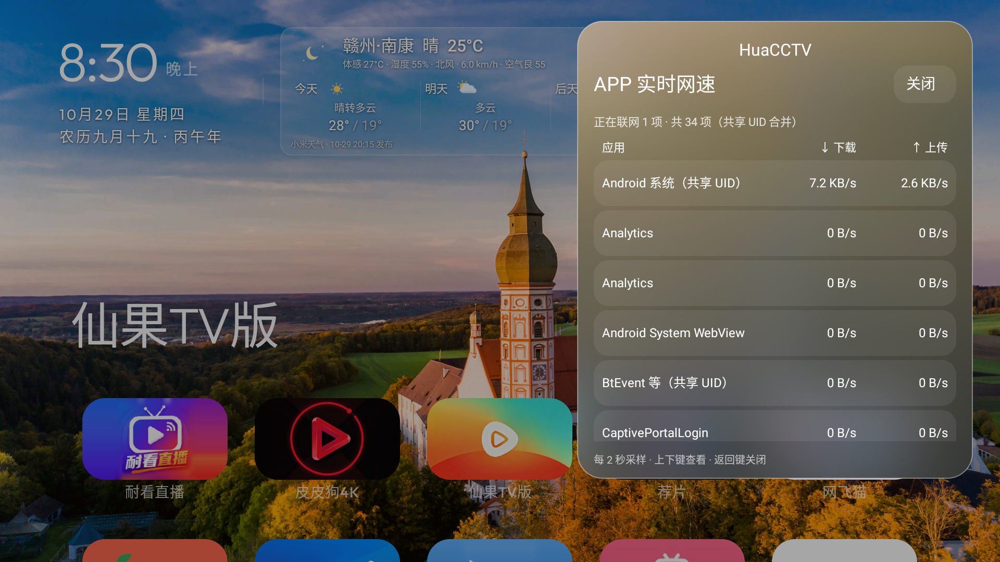
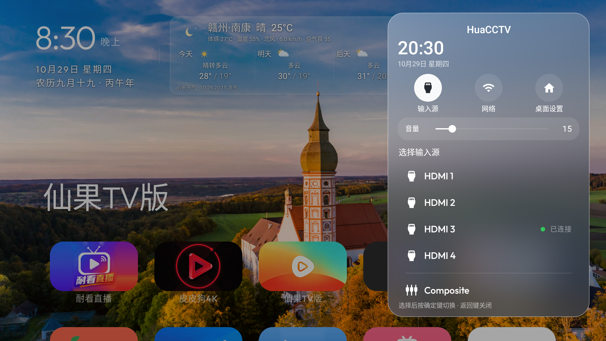
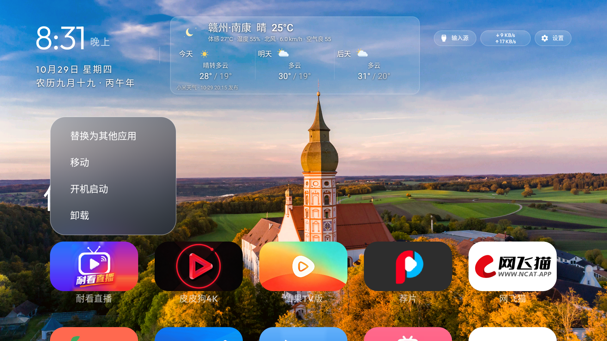

# HuaCCTV

**HuaCCTV 是基于 [cleanyourtv](https://github.com/Gathin23/cleanyourtv) 二次修改的 Android TV 简洁桌面。** 原项目由 Gathin 开发，本仓库保留原作者版权与 MIT 许可，集中整理了针对小米电视的中文界面、遥控器操作和日常使用优化。

- 原项目地址：**https://github.com/Gathin23/cleanyourtv**
- 当前版本：**5.1**（versionCode 32）
- 实机验证：小米电视 S55 / MiTV-MFTR0，Android 11 / API 30，1920×1080 输出
- 本仓库包含桌面 Android 源码及二次修改；cleanyourtv 的完整清理工具、原始文档请参阅上游仓库。

## 优化内容

| 方面 | 本次二次修改内容 |
| --- | --- |
| 桌面与启动 | 适配小米电视 HOME 路由及遥控器桌面键；增加恢复辅助服务的检查，处理关机再开机后返回小米桌面的实机问题。厂商桌面接管依赖设备配置，不能保证所有机型通用。 |
| 设置与输入源 | 设置按钮短按直接打开简洁桌面设置；布局、壁纸、轮换、动效和开机启动采用分级小窗。设置、输入源和 APP 长按菜单统一为圆角毛玻璃样式，使用桌面截图模糊与半透明叠色；窗口顶部居中显示静态 HuaCCTV。 |
| APP 网速 | 点击右上角网速按钮，打开 APP 下载/上传速度小窗；约每两秒采样，活动应用优先显示，支持遥控器滚动，关闭即停止采样。Android 共享 UID 的应用合并统计。当前实现针对 Android 11/API 30，需要通过 ADB 授予统计权限。 |
| 时间与网络 | 桌面右上角固定大小的双行上传/下载网速；打开普通 APP 后显示时分秒和网速悬浮窗；在桌面及外部输入源中隐藏悬浮窗。 |
| 中文日期 | 增加农历、干支年份；时间段显示凌晨、早上、上午、中午、下午、晚上、午夜，去掉重复问候语。 |
| 天气 | 针对实机读取小米天气来源，显示赣州·南康的当前天气以及今天、明天、后天预报；包含天气状态动画。天气数据依赖小米服务，接口变化或天气 APP 缺失时可能不可用。 |
| 壁纸管理 | 壁纸与轮换中增加局域网二维码。手机扫码后可预览、批量上传、选择和删除壁纸，调整 1–10 分钟轮换间隔。关闭电视设置即关闭管理服务；文件直接保存/删除，不保留重复备份。 |
| 图标与移动 | 根据小图标四周的颜色延展背景，并柔化边缘过渡；统一焦点框与图标圆角。移动 APP 后按一次确定即可保存并退出移动模式。 |
| 开机启动 | 列表仅展示可启动、已启用的用户安装应用，过滤系统 APP；处理小米电视电源菜单关机再开机的电源会话，使选择的 APP 按会话启动。 |
| 原生系统功能 | 提供原生投屏入口；系统设置直接调用电视自带设置，不修改小米系统设置界面。 |

## 支持范围

**不是仅限小米 S55。** APK 的最低系统版本为 Android 8.0 / API 26，可以在支持侧载 APK 的 Android TV、安卓电视和电视盒子上尝试安装。当前实测设备只有小米 S55 / MiTV-MFTR0，因此“可以安装”不代表每项厂商功能都已通过验证。

| 功能 | 兼容范围 |
| --- | --- |
| 基础桌面、图标整理、毛玻璃菜单、壁纸扫码管理 | 以 Android 8.0+ 为基础，其他品牌需实测遥控器与系统限制。 |
| APP 独立上传/下载速度 | 当前专用实现仅支持 Android 11 / API 30，且需 ADB 授予 DUMP 权限。其他版本会提示不支持。 |
| 默认 HOME、关机再开机接管、开机启动 | 受厂商 HOME 白名单、后台启动策略和权限影响；小米实机方案不能直接视为全品牌通用。 |
| 时钟/网速悬浮窗 | 需要系统允许悬浮窗和使用情况访问；前台应用、物理输入源判断依赖设备实现。 |
| 原生投屏 | 优先打开小米 SmartShare；其他品牌尝试 Android 标准 CAST_SETTINGS 入口，其含义和可用性由电视系统决定。 |
| 天气 | 当前使用小米来源和赣州·南康配置，其他地区及其他厂商设备需验证。 |

三星 Tizen、LG webOS 等不能运行 Android APK 的系统，不在本项目安装范围内。

## 实机截图

以下截图均为本次从电视直接截取的画面，展示版本 5.1。

### 打开设置



### 打开 APP 网速



### 打开输入源



### 选中 APP 后长按确定



## 编译

环境：JDK 17、Android SDK Platform 34。项目使用 Android Gradle Plugin 8.5.2 和 Gradle 8.9，包含 Gradle Wrapper。

```powershell
cd launcher
# ANDROID_HOME 指向已安装的 Android SDK，或自行创建 local.properties
.\gradlew.bat assembleRelease testReleaseUnitTest
```

Linux/macOS：

```bash
cd launcher
sh gradlew assembleRelease testReleaseUnitTest
```

APK 输出到 `launcher/app/build/outputs/apk/release/app-release.apk`。本分支默认包名为 `com.bytv.launcher`，Java 命名空间沿用 `com.gathin.tvhome`。包名是小米实机 HOME 适配的一部分；发布签名需自行管理，仓库不包含签名私钥。当前 release 构建沿用本地 debug 签名方式用于侧载。

## 安装与权限

```powershell
adb connect TV_IP:5555
adb install -r launcher/app/build/outputs/apk/release/app-release.apk
adb shell appops set com.bytv.launcher SYSTEM_ALERT_WINDOW allow
adb shell appops set com.bytv.launcher GET_USAGE_STATS allow
adb shell pm grant com.bytv.launcher android.permission.DUMP
adb shell pm grant com.bytv.launcher android.permission.WRITE_SECURE_SETTINGS
adb shell am start -n com.bytv.launcher/com.gathin.tvhome.MainActivity
```

也可使用仓库根目录的 `install.ps1 -TvHost TV_IP`。它安装已编译 APK 并配置上述权限，不禁用原厂桌面。默认桌面可在电视系统中选择；小米 HOME allowlist、原厂桌面禁用和辅助服务配置属于设备适配，请参考 [设备说明](docs/XIAOMI.md)，不要直接照搬其他机型的包名。

系统统计权限用于读取本机网络统计，没有云端上传。APP 网速窗口中的速率由同一 UID 在两次采样间的字节差值除以实际时间得到，不是累计流量。Android 11 专用接口受系统实现影响，其他版本会显示不支持，不会伪造零速率。

## 手机管理壁纸

1. 电视打开：**设置 → 个性化 → 壁纸与轮换 → 手机扫码管理壁纸**。
2. 手机与电视连接同一局域网，扫码进入管理页。
3. 支持 JPG、PNG、WebP；单张最多 10 MB，最多 100 张。
4. 可以选择固定壁纸、使用全部壁纸轮换、调整轮换间隔，或确认删除文件释放电视空间。
5. 操作时保持电视设置页面开启，完成后返回桌面生效。刷新二维码会更换访问地址，关闭设置后旧连接失效。

仓库不打包个人壁纸集合；APK 也排除了重复壁纸资源。新安装后可通过二维码上传自己的图片。截图中的壁纸和第三方 APP 图标仅用于展示实机界面。

## 测试

最新完整单元测试结果：**249 项通过**。包含壁纸管理 HTTP 会话、上传长度、来源校验、会话关闭、网速统计解析、UID 合并与计时差值等检查。随后 5.1 的输入源标题变更已完成 release 编译及实机显示验证。

## 来源与许可

本项目不是 cleanyourtv 原作者发布的官方版本。上游原始代码版权归 **Gathin**，按 [MIT License](LICENSE) 使用；HuaCCTV 二次修改也遵循 MIT。原项目链接再次列出：**https://github.com/Gathin23/cleanyourtv**。

Outfit 字体遵循 SIL Open Font License 1.1，见 [字体许可](launcher/FONT-LICENSE-OFL.txt)。二维码使用 ZXing 3.5.3，遵循 Apache License 2.0，见 [ZXing 许可](launcher/app/libs/ZXING-LICENSE.txt)。
